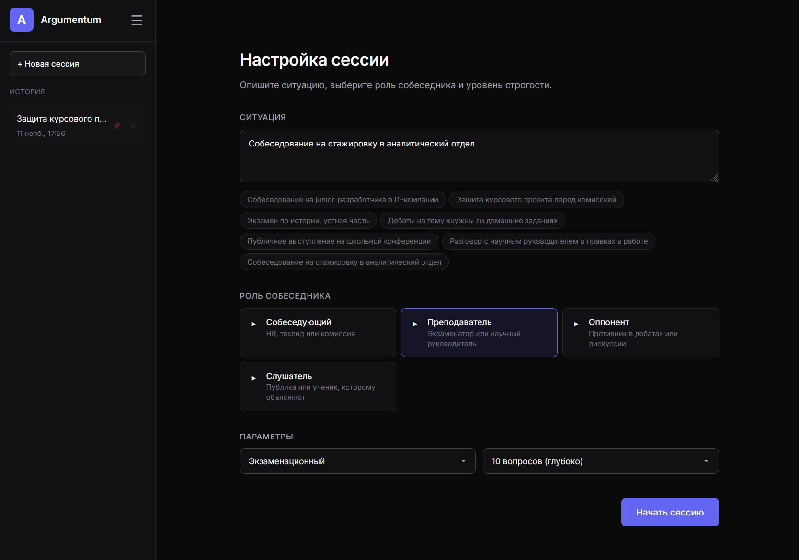
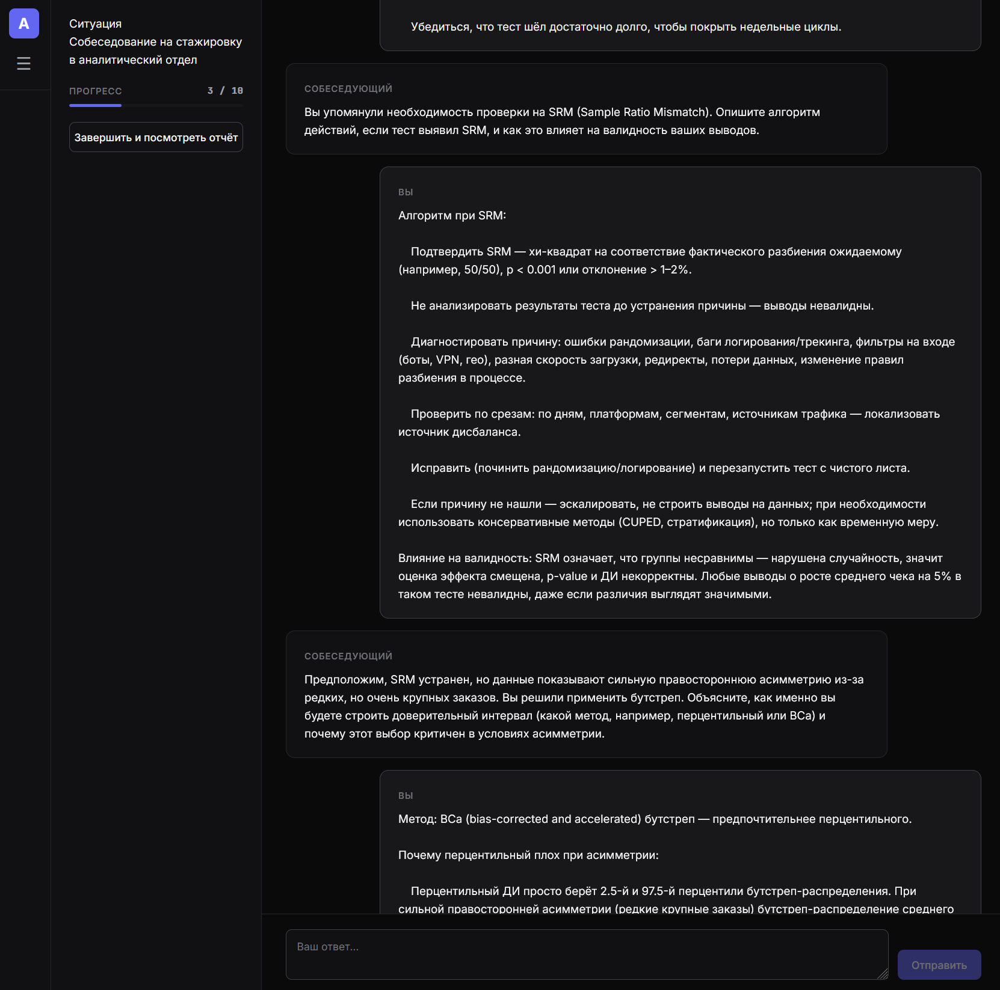
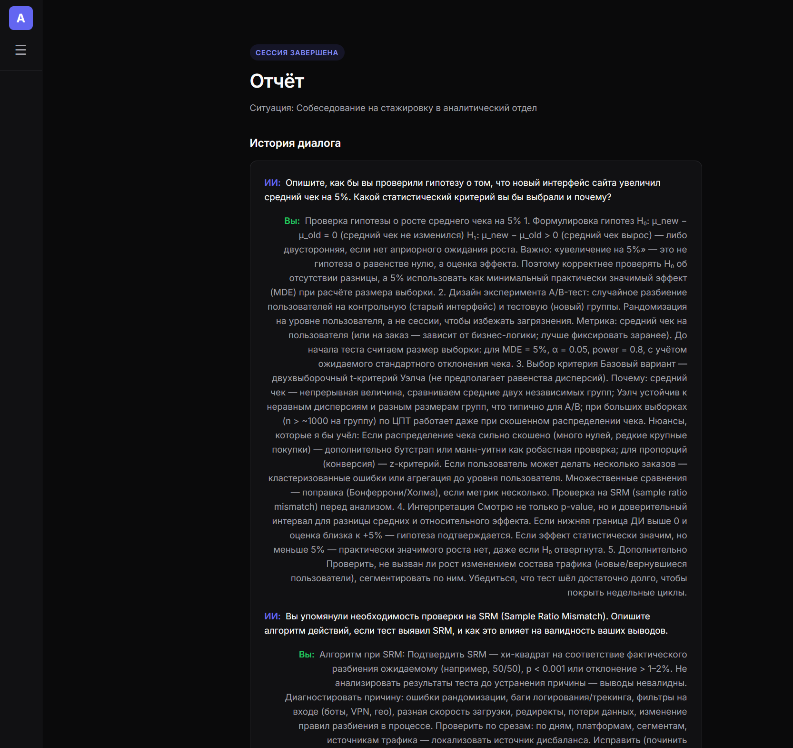
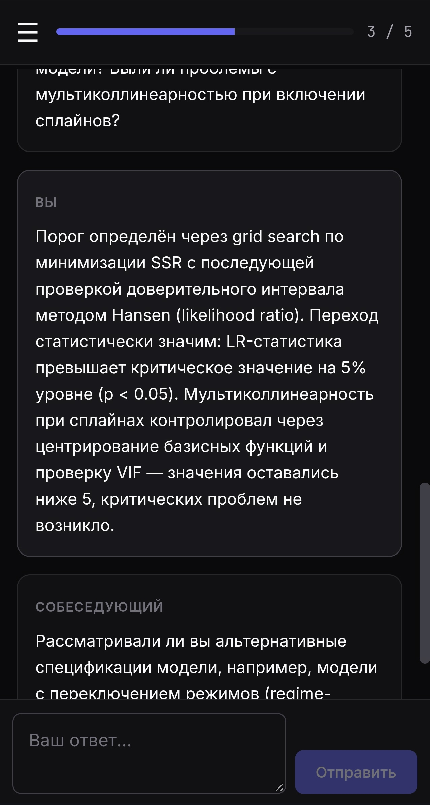

# Argumentum

**Argumentum** — это интеллектуальный веб-тренажёр для подготовки к собеседованиям, защитам проектов и экзаменам. Приложение использует нейросеть (GigaChat API), которая играет роль строгого HR-специалиста, преподавателя или оппонента, ведёт с пользователем диалог и оценивает его ответы по ходу сессии.

### Ссылка на приложение
[Открыть Argumentum](https://argumentum-app.onrender.com) 

## Возможности

- **Гибкая настройка сессии:** выбор роли ИИ (HR, Преподаватель, Оппонент, Слушатель), уровня строгости (от обучающего до экзаменационного) и количества вопросов.
- **Умный промпт-инжиниринг:** жесткий контроль длины диалога. Нейросеть строго следует сценарию, не задает лишних вопросов и корректно завершает сессию.
- **Безопасность:** запросы к API проходят через серверный прокси на PHP, что полностью скрывает API-ключи от клиента.
- **Сохранение истории:** все завершенные сессии сохраняются в `localStorage` с возможностью закрепления важных чатов.
- **Адаптивный интерфейс:** строгий темный дизайн, выезжающее меню на мобильных устройствах и фиксированный хедер.

## Скриншоты

### 1. Главный экран (Выбор параметров)
Пользователь настраивает будущую сессию: вводит ситуацию, выбирает роль ИИ, строгость и количество вопросов.

<!-- ВСТАВЬ СЮДА ФОТО ГЛАВНОГО ЭКРАНА -->

### 2. Процесс диалога
Интерфейс самого чата. Слева — панель с параметрами и прогресс-баром, справа — окно диалога с мгновенной обратной связью от ИИ.

<!-- ВСТАВЬ СЮДА ФОТО ДИАЛОГА -->

### 3. Итоговый отчет
После завершения сессии пользователь видит полную историю переписки и разбор ответов.

<!-- ВСТАВЬ СЮДА ФОТО ОТЧЕТА -->

### 4. Мобильная версия
Адаптивный интерфейс с выезжающим бургер-меню и фиксированным прогресс-баром текущей сессии.

<!-- ВСТАВЬ СЮДА ФОТО МОБИЛЬНОЙ ВЕРСИИ -->

## Техническая реализация

- **Frontend:** React (Vite), чистый CSS, Framer Motion.
- **Backend:** PHP (прокси для скрытия API-ключей).
- **AI:** GigaChat API (Сбер).
- **DevOps:** Docker, автоматический деплой на платформу Render.
